# Everyday edition: glass navigation and a living detective

13 November 2026. Local implementation; no deployment or data migration.

## Screen findings and changes

1. **Log.** The combined `95 monster` placeholder looked like a developer example.
   The small mascot repeated in the header without helping the task. Replace it
   with a large peso-led amount field, an optional named field, and an obvious
   Save expense button. Keep amount-only learning. The detective now leans on the
   form edge, looks down while input is active, inspects a recognizable amount,
   and salutes briefly after saving.
2. **Entries.** Preserve the useful period/filter/export model. Give its main
   total a clear solid surface, improve type hierarchy, and keep the record list
   quiet. No extra mascot competes with amounts.
3. **Catch-Up.** Put the inspecting detective on the active review card. Once the
   queue is finished, show the larger satisfied pose. Keep confirm/edit/later
   semantics and multiline preview intact.
4. **Settings.** Use clearly separated rounded groups with solid surfaces and
   predictable disclosure controls. Add a persistent Solid navigation preference
   alongside reduced motion. No decorative mascot is added here.

The header is wordmark-only, with a small peso edition mark. The one-time setup
handoff now travels into the Log companion slot and crossfades into the waiting
pose; it no longer relies on a header image that the design removed.

## Glass principles

[Apple's material guidance](https://developer.apple.com/design/human-interface-guidelines/materials)
describes a floating functional layer above content. Our web interpretation keeps
transparency on the bottom dock, with backdrop blur/saturation, a softly highlighted
edge, a sliding selection pill, and solid financial content underneath. It is a
CSS glass-style treatment, not Apple's native optical/refraction implementation.

The selected pill uses a single interruptible CSS transform transition; repeated
navigation retargets that transition rather than queueing animations. Tab labels
stay visible, pointer targets remain large, and navigation keeps its keyboard/ARIA
behavior. The dock is inset from the viewport edges and respects bottom safe areas.
Prompts and feedback sit above it; page padding allows every last action to scroll
clear. Both palettes are reviewed independently.

A solid default fill works without backdrop-filter support. The app's Solid
navigation setting, prefers-reduced-transparency, and increased-contrast preference
remove the glass effect. App/system reduced motion removes character motion and
shortens control transitions. Background tabs pause character animation.

## New assets and generation

Built-in ImageGen was used, with `public/brand/paper-detective.png` as the inspected
identity/style reference. The existing source was preserved. Both new PNGs retain
real alpha transparency (verified alpha min 0, max 255).

- `public/brand/detective-waiting.png`: 1293 × 1217, waiting/leaning on the expense
  card. Saved from the built-in output into the workspace without raster editing.
- `public/brand/detective-celebrating.png`: 1217 × 1293, a quiet salute for saved and
  caught-up states. Saved into the workspace without raster editing.
- `public/brand/detective-inspecting.png`: existing registered inspection frames,
  reused for the thinking state; no duplicate character is shown in the header.

### Waiting prompt

Create a new production illustration of this EXACT existing paper detective
mascot. Reference image is the character identity and style reference, not a
composition to preserve. Keep lime receipt-paper body with zigzag bottom, folded
cream corner, navy fedora with iris lavender band, coral magnifying glass, cream
gloves, dark ink outlines, subtle existing shading. A friendly waiting pose for a
finance input form: character is leaning forward with BOTH gloved hands resting
along the SAME horizontal baseline near the bottom of the illustration as if
peeking/leaning over the top edge of an input card. The right cheek rests gently
against one hand, the other holds the coral magnifying glass beside the card edge.
Eyes glance down toward the input, curious and patient, slight warm smile. Show
hat, full face, upper paper body and both hands, lower body hidden naturally behind
the imaginary card edge. The card itself MUST NOT be drawn. Absolutely no ledge,
no button, no platform, no text, no scenery, no shadows outside character, no
background. Genuinely transparent PNG. One single character, centered, wide roughly
square composition, large clean legible silhouette suitable at 180px wide in a real
mobile app. Preserve all character identity details; no new outfit or props.

### Celebration prompt

Generate one new pose of the EXACT paper detective character in the reference,
for a polished finance app's 'all caught up' state. This is a character
identity/style reference. Preserve lime receipt paper body with zigzag bottom and
cream folded corner, navy fedora with lavender iris band, coral magnifying glass,
cream gloves, dark ink outline and shoes, same warm subtle shading. Full body,
friendly quietly pleased expression, closed happy crescent eyes, one gloved hand
lifts the coral magnifying glass like a tiny celebratory salute, other hand on hip,
feet in a playful confident stance, body slightly tilted. Understated satisfaction
after helping the user, not loud excitement. Clean readable silhouette at 150px,
one centered character, comfortable transparent margins. Absolutely no confetti,
no stars, no coins, no text, no floor, no scene, no drop shadow outside the
character. Genuinely transparent background. Keep the existing mascot identity,
proportions and visual style; no different outfit, no extra props.

## Evidence and limits

Fresh before/after captures use isolated sample data, never the saved user profile.
Browser checks cover both themes, rapid navigation reversals, peso/name entry,
learned suggestions, character states, reduced motion, solid navigation, offline
assets, existing data recovery flows, and 320px layout. Native iOS/Android glass,
real-device keyboards, and assistive-technology experience are not claimed from
headless browser screenshots.

## Reviewed captures

Fresh phone captures at 393 × 852 use the same isolated scenario. The floating
dock intentionally sits above scrolling content; document padding lets the last
row/action scroll above it. The narrow-phone test separately checks that Save
expense clears the dock while entering a long amount and name.

| Screen | Before | After |
| --- | --- | --- |
| Log | 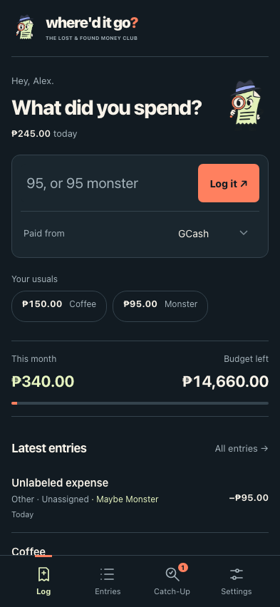 | 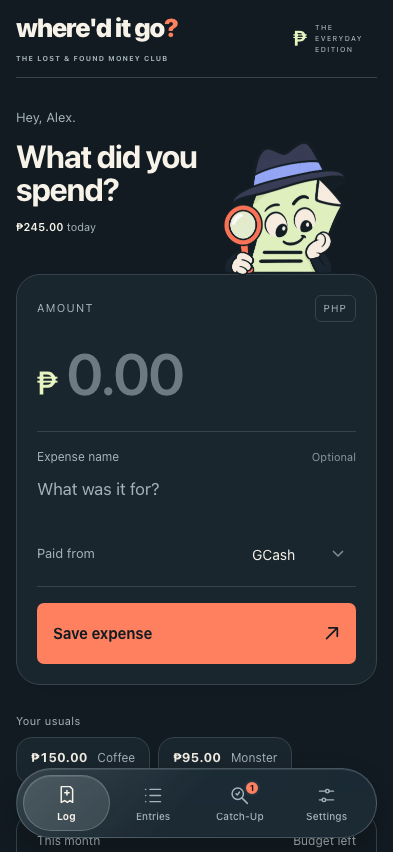 |
| Entries | 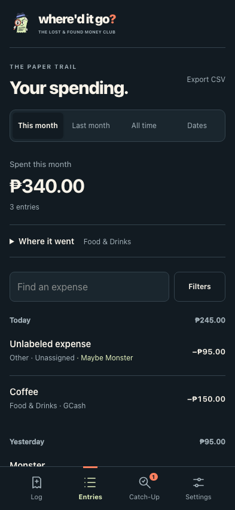 | 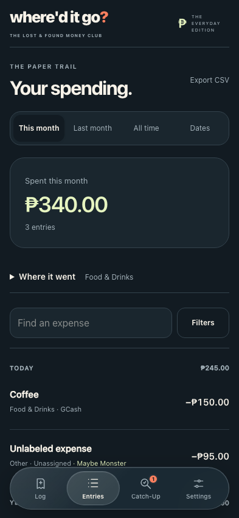 |
| Catch-Up | 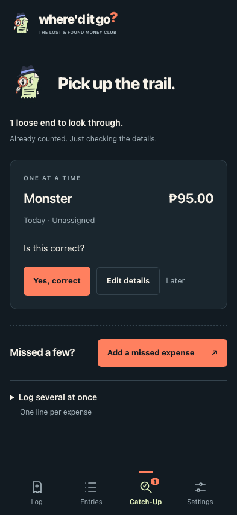 | 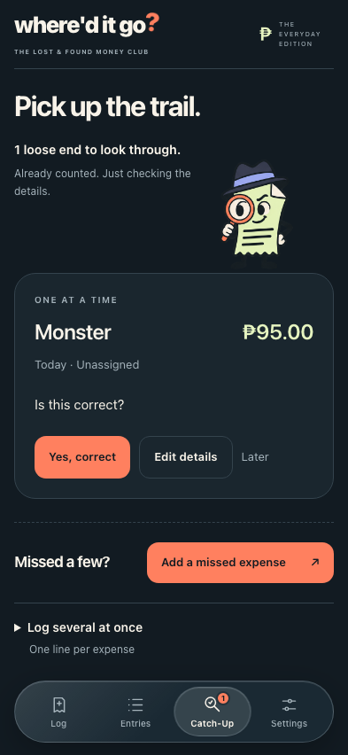 |
| Settings | 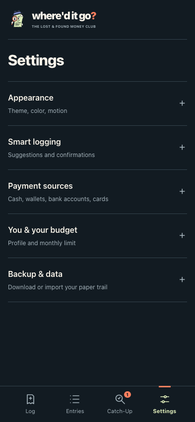 | 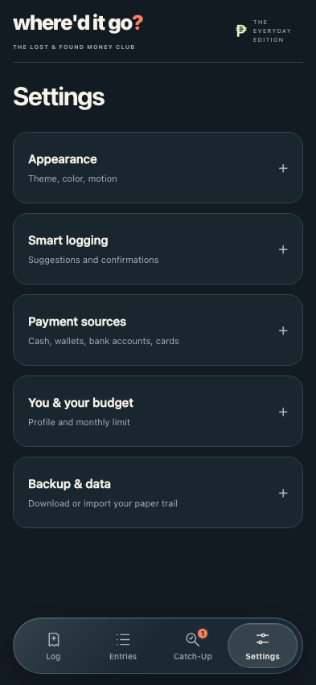 |

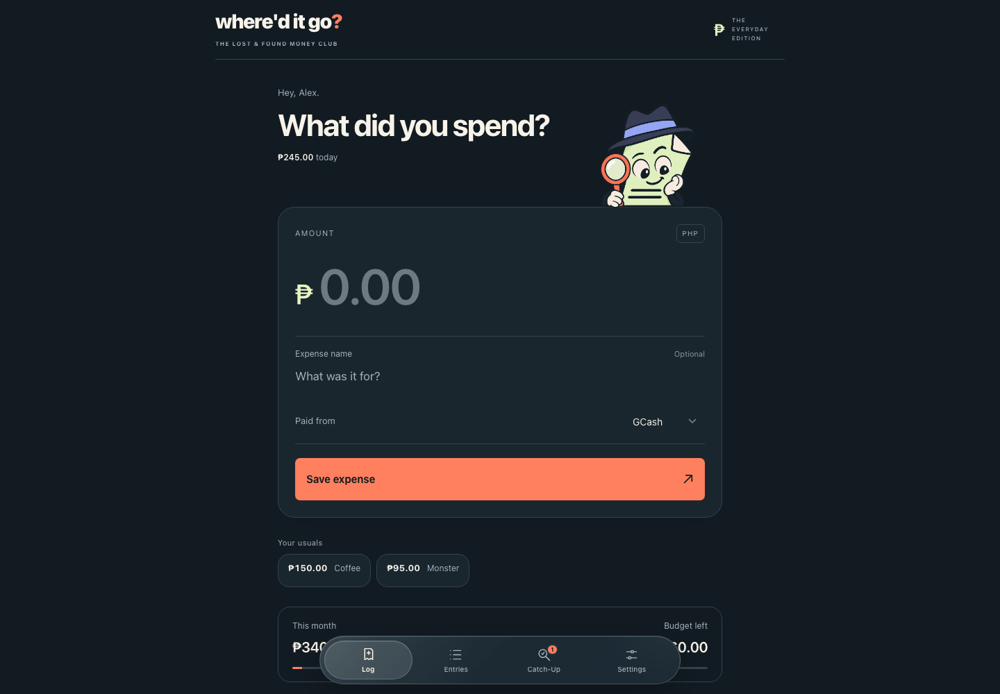

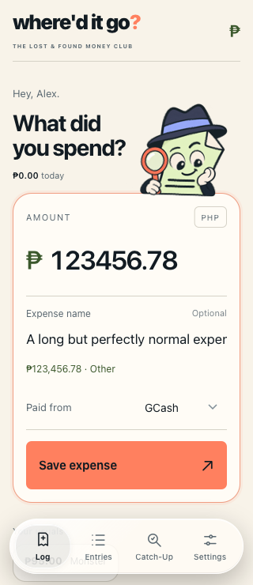

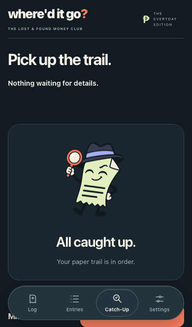

## Validation outcome

51 unit checks passed. The browser run covered 42 scenarios across desktop Chromium
and mobile WebKit; three first-pass failures were corrected and the six new visual
scenarios passed on recheck. Existing logging, persistence, account/source editing,
backup recovery, period views, batch Catch-Up, theme reversals, onboarding handoff,
keyboard flow, and offline reopening also passed. Build, lint, TypeScript, and
whitespace checks passed. The actual development stylesheet was fetched and checked.

The narrow-screen check found and fixed a partially occluded Save button; long
amounts now scale to fit. A production CSS check found that putting the prefixed
blur-reset declaration last could remove the standard reset from the built output.
Prefix-first ordering preserves both declarations and the solid-navigation browser
check now passes in Chromium and WebKit. Reduced-motion screens skip their entry
animation entirely, avoiding a transient empty frame.
