# Tarsi comparison and daily-use refinement

Research and initial-screen audit: 12 November 2026; implementation completed
on 13 November. Final comparison captures reuse the original dated fixture and
a fixed test clock so relative date labels remain comparable.

## Scope and evidence

This is a desk-research comparison of Tarsi's official product pages, published
app screenshots, pricing, and first-hand App Store reviews. Its native app was
not installed or transaction-tested. A screenshot of a marketing page is evidence
of its published interface, not verification of its underlying accounting or AI.
Reviews are individual reports from different versions, not a representative user
study. Developer responses and later changes mean historical problems may be fixed.

Our audit uses fresh, isolated test data: a working adult named Alex with mixed
cash/GCash spending, a monthly budget, and one unnamed purchase. No actual user
records were read, seeded, or changed. Browser automation was previously authorized.

## Tarsi: strengths, weaknesses, and what to learn

| Evidence | Strength | Weakness or trade-off | Our decision |
| --- | --- | --- | --- |
| [Official features](https://www.tarsi.cloud/features) | Offline entry, Philippine payment templates, natural-language logging, daily review, planning, export, and backup cover both quick and deeper use. | Broad coverage can compete for attention. Published screenshots establish presentation, not speed or accuracy. | Keep recognizable sources and learned shortcuts; separate entry from analysis. |
| [Pricing](https://www.tarsi.cloud/pricing) | A usable on-device starting point with optional advanced tools. | Account/history limits and differing Cloud/Lifetime entitlements add decisions. | Keep the current local tool coherent; no paywalls or account gates added. |
| [App Store reviews](https://apps.apple.com/ph/app/tarsi-budget-tracker/id6760278399?platform=iphone&see-all=reviews) | Reviewers praise the character, recognizable accounts, and breadth. | Some report incorrect AI categories, confusing account/category navigation, date-picker friction, and too many back steps. Later developer replies describe fixes; these are test prompts, not blanket claims about today's app. | Explicit names override predictions, guesses remain correctable, and navigation stays shallow. |
| Same review collection | Strong demand for repeatable entry and useful data ownership. | Subscription/entitlement changes have caused confusion for some reviewers. | Complete backup import; export the exact visible period as CSV. |

We are not cloning Tarsi's screen composition, claiming feature parity, or bringing
investments, debt, and cashflow guesses into an expense-only model. A feature
count is not evidence that a product fits daily life.

Published references inspected alongside the sources (not captured from an installed native app):

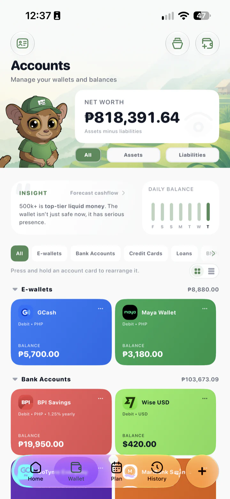

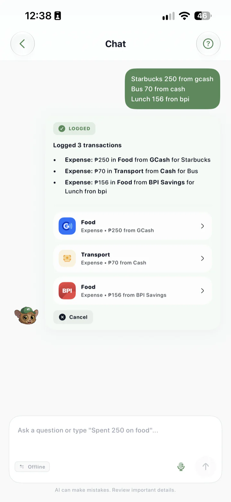

The account image uses recognizable source cards and strong net-worth hierarchy,
while also exposing several competing groups. The chat image makes the parsed
results visible, but repeats details across prose and cards. These are visual
observations about published references, not claims about the current native flow.

## Current app: screenshot audit

All images below were captured and inspected in this audit at 390 × 844. Full-page
captures include the fixed tab bar at the original viewport position; that is a
capture artifact, not a tab bar duplicated in the live scrolling page.

1. **Log a purchase.** The amount/name field and payment source are discoverable;
   learned amounts are reusable. A large summary competes with the input, and
   transaction metadata plus delete buttons make the first screen longer and more
   visually busy than the task needs. Large headings consume space on a phone.
   Recommendation: compact daily context, one entry surface, quieter monthly
   progress, no destructive action beside every row.

   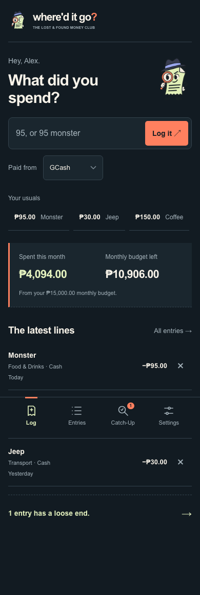

2. **Understand spending.** Search and source/category filtering exist, but the
   main total combines periods. There is no obvious monthly question to answer,
   daily grouping, or category/source summary to explore. Repeated dates add
   visual noise. Recommendation: month-first periods, grouped days with subtotals,
   expandable breakdowns that open the matching filter, and CSV of that same view.

   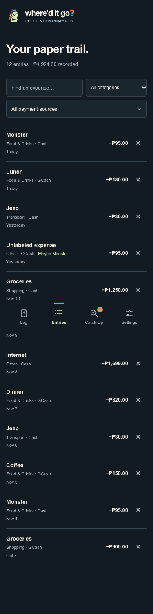

3. **Catch up.** Missing details are distinguished from new spending, which avoids
   double counting. The row's checkmark does not explain the candidate as clearly
   as a focused confirmation. Adding several forgotten purchases requires repeated
   dialogs. Recommendation: one-at-a-time review with named actions and Later,
   plus a dated multiline preview that saves only after explicit acceptance.

   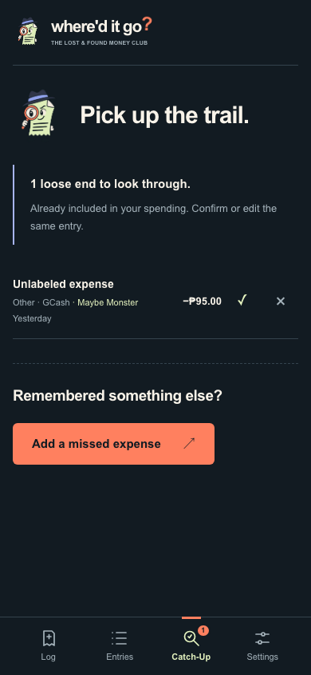

4. **Change a preference / protect data.** The long Settings form exposes unrelated
   choices at once. Backup export exists, but no import path completes recovery.
   Small muted secondary text needs a contrast check in each theme. Recommendation:
   concise expandable setting groups, a complete non-destructive import preview,
   and keyboard/motion tests beyond what screenshots can establish.

   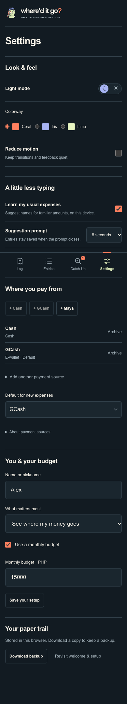

## Fundamentals applied

- **Recognize, don't remember.** Visible usuals and named payment sources reduce
  recall; every icon in the stable four-tab navigation has a text label.
  [NN/g recognition and recall](https://www.nngroup.com/articles/recognition-and-recall/)
- **Progressive disclosure.** Search and periods remain visible; advanced filters,
  detailed breakdowns, batch entry, and setting groups open when needed. Hidden
  controls remain labeled and keyboard-operable rather than depending on gestures.
  [NN/g progressive disclosure](https://www.nngroup.com/articles/progressive-disclosure/)
- **Stable navigation.** Keep all four tabs in the same order and preserve drafts
  while moving between them. Avoid nested back stacks for ordinary tasks.
  [Apple tab bars](https://developer.apple.com/design/human-interface-guidelines/tab-bars)
- **Reversible, explicit operations.** Suggestions never reinforce themselves,
  deletion moves into the editor with Undo, and imports preview new/skipped/conflict
  counts. Existing local versions win; data is merged, not silently replaced.
- **Useful feedback.** Period totals, grouped-day totals, category totals, and CSV
  share the same filtered records. Budget progress represents recorded spending,
  not a bank balance or an affordability guarantee.
- **Accessible density.** Primary controls target at least 44px, text fields use
  readable phone sizes, focus stays visible, and reduced motion preserves usable
  states. WCAG AA's target-size criterion is 24px with exceptions; 44px is our
  stronger practical target, not a claim of complete conformance.
  [W3C target size](https://www.w3.org/WAI/WCAG22/Understanding/target-size-minimum)
- **Local relevance.** Cash and e-wallets both remain first-class sources. BSP's
  2024 measurement reports 57.4% digital retail-payment volume; that supports mixed
  payment support, not assumptions about an individual user's habits or age.
  [BSP report announcement](https://www.bsp.gov.ph/SitePages/MediaAndResearch/MediaDisp.aspx?ItemId=7580&M=)

## Audience hypotheses: ages 20–40

Age alone does not establish habits. The following are scenarios to validate with
people, not demographic findings:

- At the counter or commuting: open Log, enter `95`, verify the visible source,
  save, and leave. No report or mandatory category step interrupts the task.
- Checking the month after work: open Entries, see the month total, then expand
  where it went. Tap a category/source to reach the records behind the amount.
- Returning after a busy week: Catch-Up keeps old unnamed amounts counted, reviews
  one detail at a time, and accepts several remembered purchases in a dated batch.
- Moving devices or browsers: download JSON, then preview a merge import. The UI
  makes local storage and the need for an external backup clear.

## Deferred deliberately

Recurring bills, income, account transfers, and reconciliation deserve a separate
ledger design so transfers or card payments cannot inflate expenses. Shared bills
need an explicit personal-share/receivable model. Notification capture still needs
a native Android implementation; the PWA cannot read other apps' notifications.
No automatic bank connection, OCR, voice, scheduled background task, cloud sync,
or new notification permission is implied by this iteration.

## Validation boundaries

Automated checks cover financial arithmetic, local-calendar ranges, filter
intersections, batch validation, import conflicts, legacy-field preservation,
source-ID collisions, formula-safe CSV, persistence, keyboard navigation,
reduced motion, and desktop/mobile flows. Screenshot review checks spacing,
readability, and controls in both themes. These checks cannot prove real-world
retention, screen-reader usability on physical phones, or a 20–40 audience fit.
A useful next study is five people performing the three daily scenarios without
instructions; record completion, backtracking, correction effort, and whether
period totals are understood.

## Implemented changes

1. **Log:** compact today context, a single entry surface, horizontally browsable
   learned usuals, quieter monthly progress, and no per-row delete controls.
   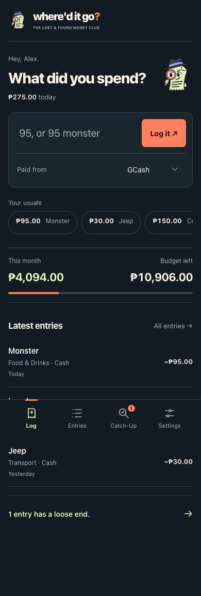
2. **Entries:** month/last month/all time/custom dates, daily groups and subtotals,
   shared category/source drilldowns, disclosed filters, and matching CSV export.
   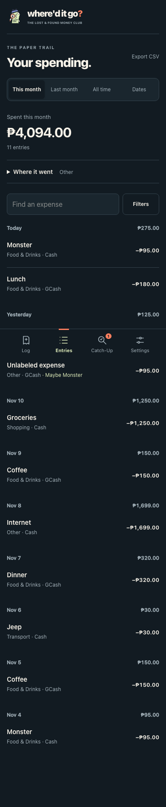
3. **Catch-Up:** one candidate at a time, explicit confirm/edit/later actions, and
   multiline dated entry with a preview before saving. Unanswered guesses remain
   flagged; nothing is silently double-counted.
   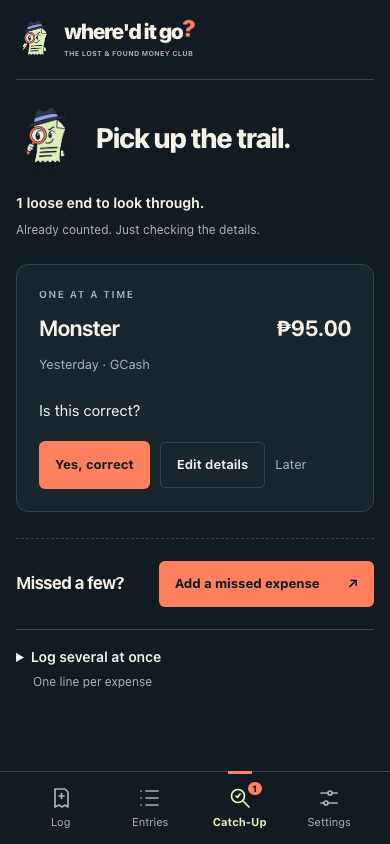
4. **Settings:** short expandable groups and import preview beside backup export.
   Imports merge new IDs and sources; current versions win on transaction conflicts.
   Conflicting source IDs are remapped so local history cannot be relabeled.
   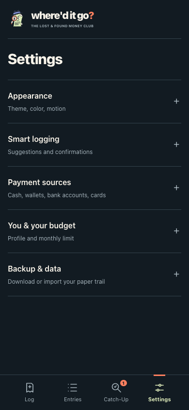

Everyday default categories now include groceries, bills, health, home, and leisure.
Custom categories can be created in the editor and reused from recorded history;
legacy categories remain distinct and filterable. Deletion lives inside that same
editor and retains Undo. No extra tab, account gate, or backend was added.

## Final verification

51 unit checks passed. The 36-test Chromium/mobile-WebKit suite passed; final
semantic, keyboard, home-navigation, and control refinements were rechecked in
focused desktop/mobile runs. Production build, lint, TypeScript, and whitespace
checks passed. The running development CSS was fetched and verified separately.

WebKit's tested Tab sequence skips native buttons and reaches the breakdown
summary inside the selected panel; Chromium reaches Export CSV. Both enter the
active screen. Tests respect the platform preference instead of forcing a global
Tab override. [Apple's keyboard-navigation settings](https://support.apple.com/en-ie/guide/safari/ibrw1075/mac)
explain Safari's configurable button/link tab behavior. This does not substitute
for physical-phone or assistive-technology testing.

Additional mobile checks (test-browser viewports, not the paired audit viewport):

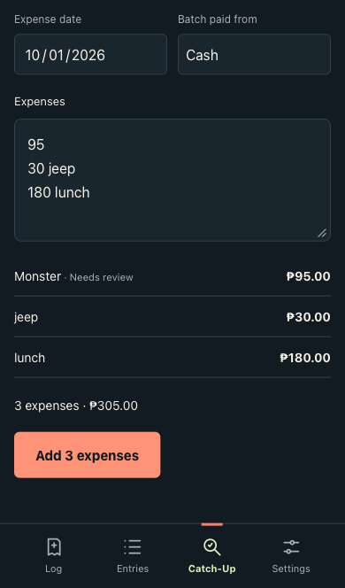

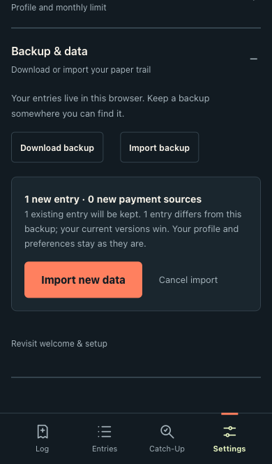

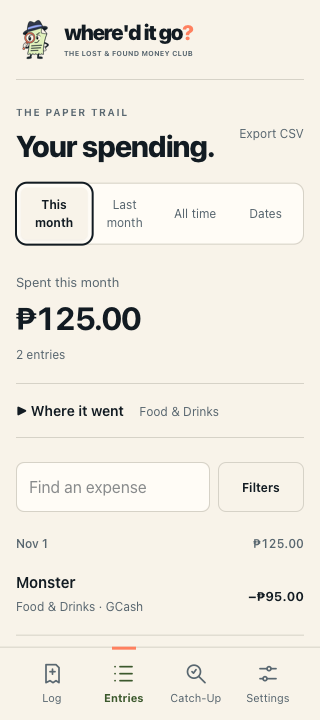
